# ☕ Dự Án Trực Quan Hóa Dữ Liệu Bán Hàng Coffee Sales — Hệ Thống Dashboard & Bộ Kịch Bản 28 Slide Thuyết Trình

> **Môn học:** Trực Quan Hóa Dữ Liệu (TQHDL)  
> **Đề tài:** Phân Tích Xu Hướng Thời Gian, Hiệu Suất Danh Mục & Xây Dựng Hệ Thống Dashboard Điều Hành Chuỗi Cà Phê (*Maven Roasters NYC*)  
> **Công nghệ:** Python (`Pandas`, `NumPy`, `Plotly`, `Matplotlib`, `Seaborn`, `Flask`) + Giao diện Quản trị **Gentelella v4 Dark Mode** (`HTML5`, `Tailwind CSS`, `Chart.js`)  
> **Bộ dữ liệu:** [Kaggle Coffee Shop Sales (Maven Roasters)](https://www.kaggle.com/datasets/ahmedabbas757/coffee-sales) — **149,116 giao dịch** (`01/01/2023` – `30/06/2023`)

---

## 👥 Bảng Phân Công Nhiệm Vụ & Trạng Thái Hoàn Thành (100%)

| STT | Thành viên | Vai trò chính | Nhiệm vụ (KPI) lõi | Module phụ trách | Trạng thái |
| :---: | :--- | :--- | :--- | :--- | :---: |
| 1 | **Tân Lưu (Leader)** | Quản lý dự án, Dashboard & Report | Thiết kế kiến trúc, dựng Web Dashboard Gentelella v4 Dark Mode, kết nối API lọc đa chiều & chuẩn bị Slide. | [`src/tan_luu_dashboard/`](src/tan_luu_dashboard/) | ✅ Hoàn thành |
| 2 | **Tân Lê** | Data Cleaning & Tiền xử lý | Kiểm định 149,116 dòng, xử lý missing/duplicate, chuẩn hóa ngày giờ và trích xuất 9 cột đặc trưng mới vào `data/clean/`. | [`src/tan_le_data_cleaning/`](src/tan_le_data_cleaning/) | ✅ Hoàn thành |
| 3 | **Quốc Thái** | Phân tích Doanh thu & Báo cáo | Phân tích chuỗi thời gian (*"Thời điểm nào bán chạy?"*): Xu hướng 6 tháng, khung giờ 06h–20h, thứ trong tuần, Heatmap & viết Report. | [`src/quoc_thai_time_series/`](src/quoc_thai_time_series/) | ✅ Hoàn thành |
| 4 | **Ngọc Phước** | Phân tích Sản phẩm & Khách hàng | Phân tích danh mục (*"Sản phẩm nào mang lại doanh thu cao?"*): Tỷ trọng 9 nhóm hàng, Top 10 món chủ lực, Ma trận Giá vs Sản lượng. | [`src/ngoc_phuoc_product_analysis/`](src/ngoc_phuoc_product_analysis/) | ✅ Hoàn thành |

---

## 🚀 Hướng Dẫn Khởi Chạy Nhanh (Quickstart)

```bash
# Bước 1: Kích hoạt môi trường ảo Python
source .venv/bin/activate

# Bước 2: Chạy Pipeline Làm sạch Dữ liệu (Tạo file data/clean/coffee_sales_cleaned.csv)
python src/tan_le_data_cleaning/data_cleaning.py

# Bước 3: Khởi chạy Web Dashboard Điều hành Gentelella v4 Dark Mode
python src/tan_luu_dashboard/app.py
```
👉 Mở trình duyệt truy cập: **`http://127.0.0.1:5000`**

---

# 📽️ BÁO CÁO TỔNG KẾT & BỘ KỊCH BẢN 28 SLIDE THUYẾT TRÌNH CHI TIẾT (KÈM BIỂU ĐỒ)

> 💡 **Hướng dẫn sử dụng để làm Slide:**
> - Toàn bộ báo cáo dưới đây được thiết kế thành **28 Slide hoàn chỉnh** (chia làm **6 Phần** rõ ràng cho 4 thành viên thay phiên nhau thuyết trình).
> - Mỗi Slide đều có: **Tiêu đề Slide**, **Nội dung bullet-point cô đọng**, **Bảng số liệu thật 100%**, **Biểu đồ PNG độ phân giải cao (đã xuất sẵn trong thư mục [`docs/charts/`](docs/charts/))** và **Lời thuyết trình (Speaker Notes)**.
> - Bạn có thể kéo trực tiếp các file ảnh biểu đồ trong `docs/charts/slide*.png` vào PowerPoint / Canva.

---

# 🟢 PHẦN I: GIỚI THIỆU ĐỀ TÀI & TỔNG QUAN DỮ LIỆU (SLIDE 1 – SLIDE 6)
*Người trình bày đề xuất: **Tân Lưu (Leader)***

---

## 🎞️ SLIDE 1: TRANG BÌA (TITLE SLIDE)
- **Tiêu đề chính:** TRỰC QUAN HÓA DỮ LIỆU BÁN HÀNG COFFEE SALES
- **Tiêu đề phụ:** Chuyển Đổi 149,116 Giao Dịch Bán Lẻ Thành Quyết Định Quản Trị Kinh Doanh Với Python & Gentelella v4 Dashboard
- **Môn học:** Trực Quan Hóa Dữ Liệu (Data Visualization)
- **Nhóm thực hiện:**
  1. **Tân Lưu (Leader):** Kiến trúc Hệ thống, Web Dashboard & Điều phối Dự án
  2. **Tân Lê:** Kỹ thuật Làm sạch Dữ liệu & Feature Engineering
  3. **Quốc Thái:** Phân tích Chuỗi thời gian & Hành vi Mua hàng
  4. **Ngọc Phước:** Phân tích Hiệu suất Danh mục & Chiến lược Sản phẩm

> 🎤 **Lời thuyết trình (Speaker Notes):**  
> *"Xin chào Thầy/Cô và các bạn. Hôm nay nhóm chúng em xin trình bày báo cáo đồ án cuối kỳ môn Trực quan hóa dữ liệu với đề tài: Phân tích và Trực quan hóa dữ liệu bán hàng chuỗi cà phê Maven Roasters tại New York. Mục tiêu của nhóm không chỉ là vẽ các biểu đồ tĩnh, mà là xây dựng một quy trình phân tích dữ liệu khép kín từ làm sạch 149,116 giao dịch thô đến hệ thống Web Dashboard điều hành thời gian thực."*

---

## 🎞️ SLIDE 2: BỐI CẢNH NGÀNH F&B & BÀI TOÁN QUẢN TRỊ THỰC TẾ
- **Đặc thù ngành kinh doanh chuỗi cà phê (F&B Retail):**
  - Tần suất giao dịch cực lớn trong ngày (hàng trăm đến hàng nghìn hóa đơn mỗi điểm bán).
  - Biên lợi nhuận phụ thuộc chặt chẽ vào **tốc độ phục vụ giờ cao điểm**, **định lượng nguyên vật liệu tươi** (sữa, hạt cà phê, bánh ngọt) và **cấu trúc thực đơn (Menu Mix)**.
- **Nỗi đau (Pain Points) của người quản lý khi chỉ nhìn bảng Excel thô:**
  - Không biết chính xác **khung giờ nào quầy pha chế bị quá tải** để xếp ca nhân viên (Barista) hợp lý.
  - Không phân biệt được đâu là **"mặt hàng ngôi sao" (Cash Cows)** mang lại 80% doanh thu và đâu là mặt hàng tồn đọng vốn.
  - Khó theo dõi sự khác biệt về thị hiếu khách hàng giữa các khu vực địa lý (Khu tài chính văn phòng vs. Khu dân cư/du lịch).

> 🎤 **Lời thuyết trình:**  
> *"Trong ngành F&B nói chung và chuỗi cà phê nói riêng, mỗi ngày cửa hàng phát sinh hàng ngàn dòng hóa đơn. Nếu người quản lý chỉ nhìn vào file Excel hàng trăm ngàn dòng, họ sẽ không thể trả lời nhanh được việc ngày mai cần xếp bao nhiêu nhân viên pha chế vào lúc 8 giờ sáng, hay món đồ uống nào đang gánh doanh thu cho cả quán. Đó là lý do trực quan hóa dữ liệu đóng vai trò sống còn."*

---

## 🎞️ SLIDE 3: MỤC TIÊU DỰ ÁN & 2 CÂU HỎI NGHIÊN CỨU TRỌNG TÂM
- **4 Mục tiêu cốt lõi của dự án:**
  1. **Làm sạch dữ liệu tuyệt đối (Nguyên tắc 1):** Đảm bảo 0% dữ liệu khuyết thiếu, chuẩn hóa định dạng thời gian và tiền tệ bằng `Pandas`.
  2. **Kể chuyện qua dữ liệu (Data Storytelling - Nguyên tắc 2):** Mỗi biểu đồ truyền tải một thông điệp quản trị rõ ràng, trực diện.
  3. **Trả lời 2 câu hỏi kinh doanh sống còn:**
     - ❓ **Câu hỏi 1:** *"Thời điểm nào bán chạy nhất?"* (Theo Tháng, Ngày, Khung giờ 06h–20h, Thứ trong tuần).
     - ❓ **Câu hỏi 2:** *"Sản phẩm và Danh mục nào mang lại doanh thu cao nhất?"* (Theo 9 Danh mục, 29 Dòng sản phẩm, 80 Món chi tiết).
  4. **Đóng gói thành Web Dashboard tương tác:** Xây dựng ứng dụng Web bằng Python `Flask` + `Gentelella v4 Dark Mode` hỗ trợ lọc đa chiều.

---

## 🎞️ SLIDE 4: TẠI SAO NHÓM CHỌN ĐỀ TÀI NÀY?
- **1. Tính gần gũi & Ứng dụng thực tiễn cao:**
  - Mô hình quán cà phê rất quen thuộc, giúp nhóm dễ dàng kiểm chứng tính hợp lý của các phát hiện (Insights) như thói quen uống cà phê sáng đầu tuần của dân công sở.
- **2. Độ đa dạng hoàn hảo của Bộ dữ liệu cho môn Trực quan hóa:**
  - Chứa đầy đủ các kiểu biến: **Thời gian** (`Date`, `Time`), **Định tính phân cấp 3 tầng** (`Category` $\rightarrow$ `Type` $\rightarrow$ `Detail`), **Không gian** (`3 Chi nhánh NYC`), và **Định lượng** (`Quantity`, `Unit Price`, `Revenue`).
  - Cho phép triển khai hơn **10 dạng biểu đồ chuyên sâu**: Spline Area, Combo Bar-Line, 2D Heatmap, Donut, Pareto 80/20, Ranked Horizontal Bar, Scatter Bubble, Stacked Bar.
- **3. Phù hợp tuyệt đối với mô hình làm việc nhóm 4 thành viên:**
  - Kiến trúc phân tách rõ ràng (Data Cleaning $\rightarrow$ Time-Series $\rightarrow$ Product Analytics $\rightarrow$ Web Dashboard), không giẫm chân hay xung đột mã nguồn trên Git.

---

## 🎞️ SLIDE 5: TỔNG QUAN BỘ DỮ LIỆU & TỪ ĐIỂN DỮ LIỆU (DATA DICTIONARY)
- **Nguồn dữ liệu:** Bộ dữ liệu *Coffee Shop Sales (Maven Roasters)* trên Kaggle (`data/raw/coffee_shop_sales.csv`).
- **Quy mô:** **149,116 bản ghi** $\times$ **11 cột thuộc tính gốc** (181 ngày từ `01/01/2023` đến `30/06/2023`).

| STT | Tên cột gốc | Kiểu dữ liệu | Ý nghĩa nghiệp vụ | Miền giá trị thực tế trong Dataset |
| :---: | :--- | :---: | :--- | :--- |
| 1 | `transaction_id` | Integer | Mã định danh hóa đơn duy nhất | `1` $\rightarrow$ `149,456` (149,116 đơn duy nhất) |
| 2 | `transaction_date` | Date | Ngày phát sinh giao dịch | `01-01-2023` $\rightarrow$ `30-06-2023` (181 ngày) |
| 3 | `transaction_time` | Time | Thời gian thực hiện giao dịch | `06:00:00` $\rightarrow$ `20:59:32` (15 khung giờ/ngày) |
| 4 | `transaction_qty` | Integer | Số lượng sản phẩm mua trong dòng đơn | `1` $\rightarrow$ `8` sản phẩm / lượt |
| 5 | `store_id` | Integer | Mã định danh chi nhánh | `3`, `5`, `8` |
| 6 | `store_location` | String | Tên chi nhánh tại New York | `Hell's Kitchen`, `Astoria`, `Lower Manhattan` |
| 7 | `product_id` | Integer | Mã định danh sản phẩm | `1` $\rightarrow$ `87` |
| 8 | `unit_price` | Float | Đơn giá bán lẻ niêm yết (\$) | `\$0.80` $\rightarrow$ `\$45.00` (Trung bình: `\$3.38`) |
| 9 | `product_category` | String | Danh mục sản phẩm cấp 1 (9 nhóm) | `Coffee`, `Tea`, `Bakery`, `Drinking Chocolate`... |
| 10 | `product_type` | String | Dòng sản phẩm cấp 2 (29 dòng) | `Barista Espresso`, `Brewed Chai tea`, `Scone`... |
| 11 | `product_detail` | String | Tên món chi tiết cấp 3 + Size (80 món) | `Latte Rg`, `Cappuccino Lg`, `Dark chocolate Lg`... |

---

## 🎞️ SLIDE 6: KIẾN TRÚC LUỒNG DỮ LIỆU & PHỐI HỢP NHÓM (WORKFLOW)

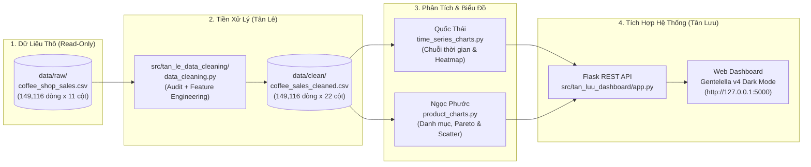

- **Nguyên tắc kỹ thuật bất di bất dịch:** Tuyệt đối không ghi đè file gốc tại `data/raw/`. Mọi biểu đồ và API đều đọc từ nguồn chuẩn hóa duy nhất tại `data/clean/coffee_sales_cleaned.csv`.

---

# 🟣 PHẦN II: QUY TRÌNH LÀM SẠCH DỮ LIỆU & TIỀN XỬ LÝ (SLIDE 7 – SLIDE 10)
*Người trình bày đề xuất: **Tân Lê (Data Cleaning & Preprocessing)***

---

## 🎞️ SLIDE 7: KIỂM ĐỊNH CHẤT LƯỢNG DỮ LIỆU THÔ (DATA QUALITY AUDIT)

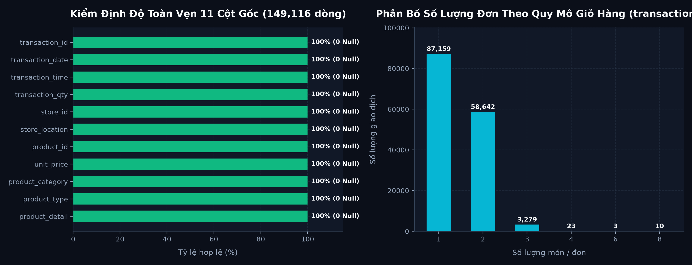

- **Kết quả kiểm định tự động bằng Python (`data_cleaning.py`):**
  - **Độ toàn vẹn (Completeness):** 11/11 cột đạt **100% dữ liệu hợp lệ** (`0` giá trị Null / Missing).
  - **Tính duy nhất (Uniqueness):** `0` bản ghi trùng lặp (`duplicated().sum() == 0`).
  - **Phân bố số lượng mua mỗi đơn (`transaction_qty`):**
    - Đơn mua **1 món** chiếm đa số với **87,159 giao dịch (58.45%)**.
    - Đơn mua **2 món** đạt **58,642 giao dịch (39.33%)**.
    - Đơn mua **3–8 món** (nhóm khách đi theo nhóm/văn phòng) chiếm **3,315 giao dịch (2.22%)**.

> 🎤 **Lời thuyết trình (Tân Lê):**  
> *"Ở bước đầu tiên của pipeline làm sạch, em tiến hành quét toàn bộ 149,116 bản ghi để kiểm tra lỗi khuyết thiếu và trùng lặp. Kết quả kiểm định cho thấy bộ dữ liệu đạt độ toàn vẹn 100% trên cả 11 trường. Biểu đồ bên phải cho thấy hành vi mua sắm đặc trưng tại quán cà phê: 97.8% hóa đơn mua từ 1 đến 2 món, phản ánh nhu cầu mua mang đi (take-away) cá nhân rất cao."*

---

## 🎞️ SLIDE 8: PHÂN PHỐI ĐƠN GIÁ (`unit_price`) & GIÁ TRỊ ĐƠN HÀNG (`revenue`)

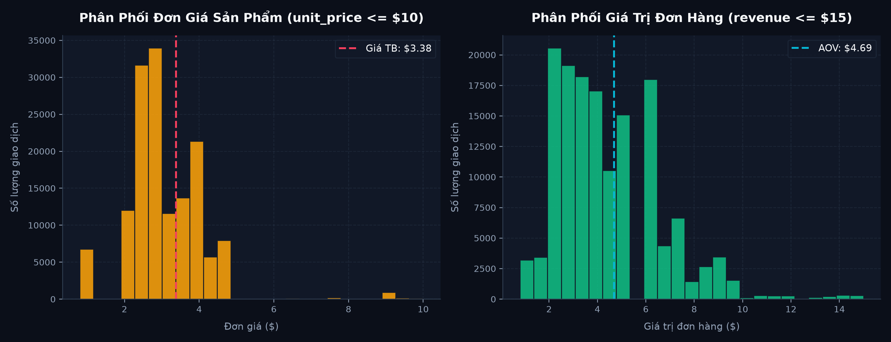

- **Phân tích Phân phối Đơn giá (`unit_price`):**
  - Giá trị nhỏ nhất: **\$0.80** (các loại Syrup thêm hương vị `Flavours`).
  - Giá trị phổ biến nhất (Mode & Median): **\$3.00 – \$3.75** (nhóm Cà phê pha máy, Trà và Bánh ngọt).
  - Giá trị trung bình (Mean): **\$3.38 / sản phẩm**.
  - Các giá trị cao từ **\$18.00 – \$45.00** không phải lỗi nhập liệu (outliers lỗi) mà là nhóm **Hạt cà phê đóng gói cao cấp (`Civet Cat`, `Jamaica Blue Mountain`)** và **Áo/Bình giữ nhiệt thương hiệu (`Branded`)**.
- **Phân tích Phân phối Giá trị Đơn hàng (`revenue`):**
  - Trung bình mỗi hóa đơn mang về **AOV = \$4.69**, tập trung dày đặc nhất ở ngưỡng **\$3.00 – \$9.00**.

---

## 🎞️ SLIDE 9: KỸ THUẬT TRÍCH XUẤT 9 ĐẶC TRƯNG MỚI (FEATURE ENGINEERING)

Từ 11 cột gốc, script [`src/tan_le_data_cleaning/data_cleaning.py`](src/tan_le_data_cleaning/data_cleaning.py) chuẩn hóa và tạo thêm **11 cột mở rộng** (tổng cộng **22 cột** trong file sạch):

| STT | Tên cột mới | Công thức / Quy tắc trích xuất | Giá trị mẫu | Phục vụ phân tích của |
| :---: | :--- | :--- | :--- | :--- |
| 1 | **`revenue`** | `round(transaction_qty * unit_price, 2)` | `6.00`, `9.50` | Toàn bộ KPI & Biểu đồ doanh thu |
| 2 | **`hour`** | `pd.to_datetime(transaction_time).dt.hour` | `6` $\rightarrow$ `20` | Biểu đồ khung giờ & Heatmap (Quốc Thái) |
| 3 | **`time_slot`** | Phân nhóm 4 ca theo `hour` (Sáng/Trưa/Chiều/Tối) | `Ca Sáng Cao Điểm (06h-10h)` | Phân tích hiệu suất theo ca trực |
| 4 | **`year`** | `transaction_date.dt.year` | `2023` | Kiểm tra miền thời gian |
| 5 | **`month`** | `transaction_date.dt.month` | `1` $\rightarrow$ `6` | Bộ lọc tháng & Xu hướng 6 tháng |
| 6 | **`month_year`** | `transaction_date.dt.strftime('%Y-%m')` | `2023-01` $\rightarrow$ `2023-06` | Chuỗi thời gian theo tháng |
| 7 | **`month_label`**| Ánh xạ tên tháng tiếng Việt | `Tháng 01/2023` | Hiển thị nhãn biểu đồ |
| 8 | **`day_of_week`**| `transaction_date.dt.day_of_week` | `0` (Thứ 2) $\rightarrow$ `6` (CN) | Sắp xếp đúng thứ tự ngày trong tuần |
| 9 | **`day_name`** | `transaction_date.dt.day_name()` | `Monday` $\rightarrow$ `Sunday` | Phân tích ngày trong tuần |
| 10 | **`day_name_vn`**| Ánh xạ thứ tiếng Việt | `Thứ 2` $\rightarrow$ `Chủ Nhật` | Hiển thị trục Y của Heatmap |
| 11 | **`is_weekend`** | `day_of_week.isin([5, 6])` | `True` / `False` | So sánh Ngày thường vs. Cuối tuần |

---

## 🎞️ SLIDE 10: KẾT QUẢ ĐẦU RA TẦNG DỮ LIỆU SẠCH (`data/clean/coffee_sales_cleaned.csv`)
- **Đường dẫn xuất chuẩn hóa:** `data/clean/coffee_sales_cleaned.csv`
- **Thống kê kiểm toán sau làm sạch (Audit Summary):**
  - Tổng số bản ghi sạch: **149,116 dòng** (Tỷ lệ giữ lại: **100%**).
  - Tổng số thuộc tính: **22 cột** (11 cột gốc + 11 cột dẫn xuất).
  - Tổng doanh thu kiểm toán: **\$698,812.33**.
  - Tổng sản lượng kiểm toán: **214,470 đơn vị sản phẩm**.
  - Thời gian xử lý toàn bộ 149,116 dòng bằng Pandas: **< 0.85 giây**.

---

# 🔵 PHẦN III: BỨC TRANH TOÀN CẢNH KPI & SO SÁNH 3 CHI NHÁNH NYC (SLIDE 11 – SLIDE 13)
*Người trình bày đề xuất: **Tân Lưu (Leader)***

---

## 🎞️ SLIDE 11: BẢNG ĐIỀU KHIỂN 6 CHỈ SỐ KPI CỐT LÕI TOÀN CHUỖI (6 THÁNG 2023)

| Nhóm chỉ số | Tên KPI | Con số thực tế | Chi tiết bổ trợ |
| :--- | :--- | :---: | :--- |
| **1. Quy mô Doanh thu** | **Tổng Doanh Thu (Total Revenue)** | **\$698,812.33** | Trung bình thu **\$3,860.84 / ngày** trên toàn chuỗi |
| **2. Quy mô Sản lượng** | **Tổng Lượng Bán Ra (Total Volume)** | **214,470 món** | Trung bình bán **1,185 ly & bánh / ngày** |
| **3. Lưu lượng Khách** | **Tổng Số Hóa Đơn (Transactions)** | **149,116 đơn** | Trung bình phục vụ **824 lượt đơn / ngày** |
| **4. Giá trị Giỏ hàng** | **Giá Trị Đơn Trung Bình (AOV)** | **\$4.69 / đơn** | Đơn giá TB: **\$3.38/món** • Quy mô đơn: **1.44 món/đơn** |
| **5. Sản phẩm Ngôi sao** | **Món Có Doanh Thu Cao Nhất** | **Sustainably Grown Organic Lg** | Đạt **\$21,151.75** (4,453 ly — chiếm 3.03% toàn chuỗi) |
| **6. Điểm bán Dẫn đầu** | **Chi Nhánh Doanh Thu Số 1** | **Hell's Kitchen** | Đạt **\$236,511.17** (50,735 đơn — chiếm 33.84% toàn chuỗi) |

---

## 🎞️ SLIDE 12: SO SÁNH HIỆU SUẤT KINH DOANH GIỮA 3 CHI NHÁNH NYC

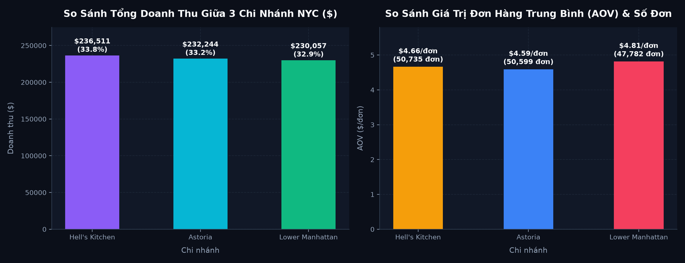

| Hạng | Chi nhánh (`store_location`) | Mã Store | Doanh thu (\$) | Tỷ trọng (%) | Sản lượng (Món) | Số đơn hàng | AOV (\$/đơn) | Số món TB / đơn |
| :---: | :--- | :---: | :---: | :---: | :---: | :---: | :---: | :---: |
| **1** | **Hell's Kitchen** | Store #8 | **\$236,511.17** | **33.84%** | 71,737 | **50,735** | \$4.66 | 1.41 |
| **2** | **Astoria** | Store #3 | **\$232,243.91** | **33.23%** | 70,991 | 50,599 | \$4.59 | 1.40 |
| **3** | **Lower Manhattan** | Store #5 | **\$230,057.25** | **32.92%** | **71,742** | 47,782 | **\$4.81** | **1.50** |
| — | **Tổng / Trung bình** | **3 Stores** | **\$698,812.33** | **100.00%** | **214,470** | **149,116** | **\$4.69** | **1.44** |

- **Phát hiện quan trọng (Key Insights):**
  1. **Sự cân bằng đáng kinh ngạc:** Cả 3 chi nhánh đều đóng góp xấp xỉ **1/3 doanh thu toàn chuỗi** (chênh lệch giữa chi nhánh số 1 và số 3 chỉ là \$6,453.92 tương đương 0.92%).
  2. **Điểm đặc biệt tại Lower Manhattan:** Tuy có số lượng hóa đơn thấp nhất (47,782 đơn), nhưng **Lower Manhattan lại dẫn đầu về tổng số lượng món bán ra (71,742 món)** và có **AOV cao nhất (\$4.81/đơn)**. Lý do: Đây là trung tâm tài chính văn phòng, nhân viên công sở thường đặt mua chung nhiều ly trên một hóa đơn (1.50 món/đơn).

---

## 🎞️ SLIDE 13: ĐỐI CHIẾU TỐC ĐỘ TĂNG TRƯỞNG 6 THÁNG CỦA TỪNG CHI NHÁNH

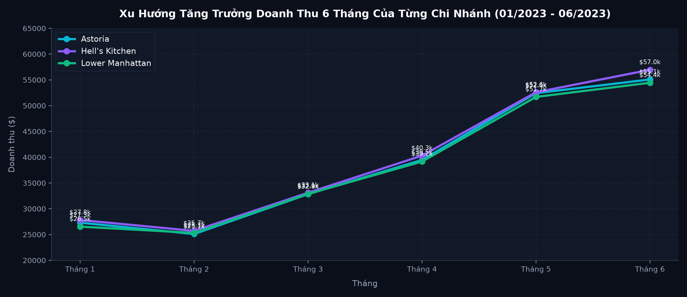

| Tháng | Hell's Kitchen (\$) | Astoria (\$) | Lower Manhattan (\$) | Tổng Toàn Chuỗi (\$) |
| :--- | :---: | :---: | :---: | :---: |
| **Tháng 01/2023** | \$27,820.65 | \$27,313.66 | \$26,543.43 | **\$81,677.74** |
| **Tháng 02/2023** | \$25,719.80 | \$25,105.34 | \$25,320.05 | **\$76,145.19** |
| **Tháng 03/2023** | \$33,110.57 | \$32,835.43 | \$32,888.68 | **\$98,834.68** |
| **Tháng 04/2023** | \$40,304.14 | \$39,477.61 | \$39,159.33 | **\$118,941.08** |
| **Tháng 05/2023** | \$52,598.93 | \$52,428.76 | \$51,700.07 | **\$156,727.76** |
| **Tháng 06/2023** | **\$56,957.08** | **\$55,083.11** | **\$54,445.69** | **\$166,485.88** |

- **Nhận xét:** Cả 3 đường biểu diễn của 3 chi nhánh gần như song hành tuyệt đối từ Tháng 1 đến Tháng 6. Điều này chứng tỏ **sự bùng nổ doanh số (+103.8%) là xu hướng chung của toàn hệ thống thương hiệu Maven Roasters** chứ không phải hiện tượng cục bộ tại một địa điểm.

---

# 🩵 PHẦN IV: PHÂN TÍCH CHUỖI THỜI GIAN — "THỜI ĐIỂM NÀO BÁN CHẠY?" (SLIDE 14 – SLIDE 19)
*Người trình bày đề xuất: **Quốc Thái (Time-Series & Revenue Analysis)***

---

## 🎞️ SLIDE 14: XU HƯỚNG TĂNG TRƯỞNG DOANH THU QUA 6 THÁNG (01/2023 – 06/2023)

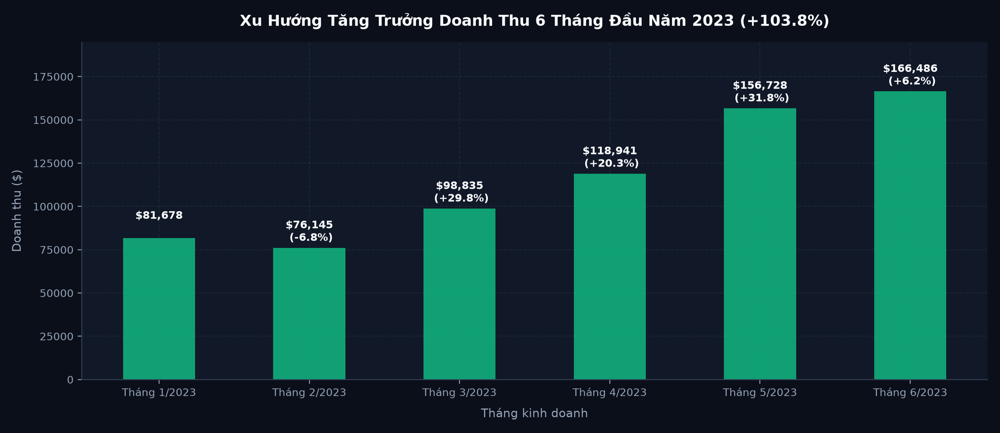

- **Phân tích chu kỳ tăng trưởng theo tháng:**
  - **Giai đoạn Mùa Đông (Tháng 1 – Tháng 2):** Doanh thu ở mức nền **\$81.7k** và **\$76.1k** (Tháng 2 giảm nhẹ 6.8% do chỉ có 28 ngày; nếu tính trung bình ngày thì Tháng 2 đạt **\$2,719/ngày**, cao hơn mức **\$2,635/ngày** của Tháng 1!).
  - **Giai đoạn Bứt phá Mùa Xuân (Tháng 3 – Tháng 4):** Tăng vọt **+29.8%** trong Tháng 3 (\$98.8k) và tiếp tục tăng **+20.3%** trong Tháng 4 (\$118.9k).
  - **Giai đoạn Đỉnh cao Đầu Hè (Tháng 5 – Tháng 6):** Tháng 5 tăng tốc mạnh mẽ nhất (**+31.8%**, đạt \$156.7k) và Tháng 6 lập kỷ lục **\$166,485.88** (35,352 đơn).

> 🎤 **Lời thuyết trình (Quốc Thái):**  
> *"Để trả lời câu hỏi đầu tiên 'Thời điểm nào bán chạy?', trước hết chúng ta nhìn vào bức tranh vĩ mô 6 tháng đầu năm 2023. Biểu đồ cho thấy doanh thu của chuỗi tăng trưởng hơn gấp đôi, từ 81,678 đô la vào tháng 1 lên 166,486 đô la vào tháng 6 (+103.8%). Đặc biệt, tháng 2 nhìn tổng số có vẻ giảm nhẹ nhưng thực chất do tháng 2 chỉ có 28 ngày — doanh thu trung bình mỗi ngày thực tế vẫn tăng đều đặn qua từng tháng."*

---

## 🎞️ SLIDE 15: BIẾN ĐỘNG DOANH THU 181 NGÀY LIÊN TỤC & ĐƯỜNG TRUNG BÌNH TRƯỢT (MA7)

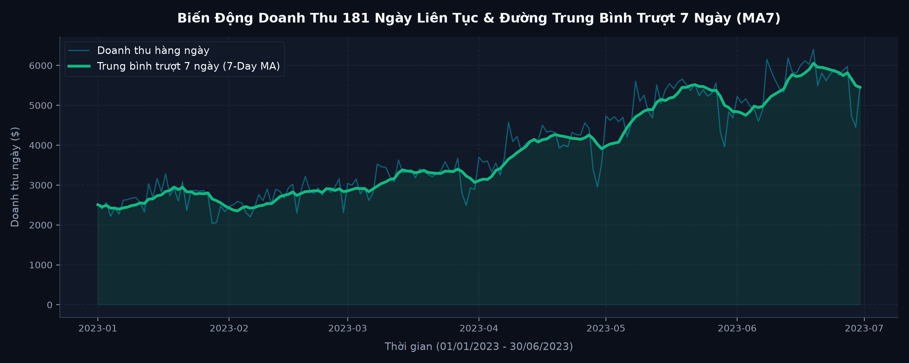

- **Ý nghĩa của Đường Trung bình trượt 7 ngày (7-Day Moving Average - MA7):**
  - Làm mượt các dao động ngắn hạn giữa ngày thường và cuối tuần để lộ rõ **đường xu hướng tăng trưởng bậc thang (Step-wise Uptrend)**.
  - Doanh thu trung bình ngày tăng từ mức **~\$2,600/ngày** (đầu tháng 1) lên mức **~\$5,550/ngày** (cuối tháng 6).
  - Không có bất kỳ ngày nào cửa hàng đóng cửa hay sập nguồn thu đột ngột, phản ánh hệ thống vận hành cực kỳ ổn định.

---

## 🎞️ SLIDE 16: PHÂN TÍCH KHUNG GIỜ MỞ CỬA (06:00 – 20:59) & "KHUNG GIỜ VÀNG"

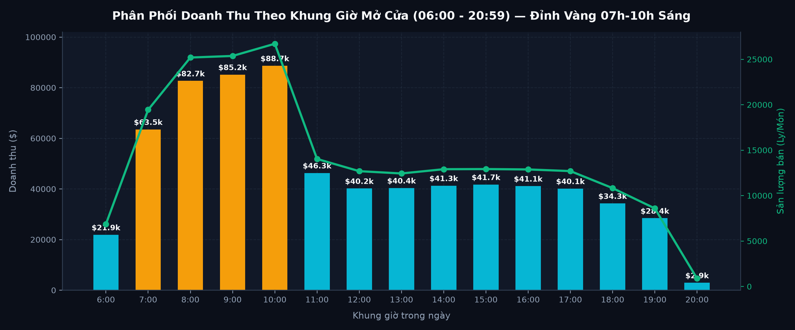

### Bảng Chi Tiết Doanh Thu & Sản Lượng Qua 15 Khung Giờ Hoạt Động
| Khung giờ | Doanh thu (\$) | Sản lượng (Món) | Số đơn hàng | Tỷ trọng Doanh thu (%) | Mức độ tải tại quầy |
| :---: | :---: | :---: | :---: | :---: | :--- |
| **06:00 – 06:59** | \$21,900.27 | 6,865 | 4,594 | 3.13% | 🟢 Khởi động ca sáng |
| **07:00 – 07:59** | **\$63,526.47** | 19,449 | 13,428 | **9.09%** | 🔥 Tăng tốc mạnh (+190% so với 6h) |
| **08:00 – 08:59** | **\$82,699.87** | 25,197 | 17,654 | **11.83%** | 🚨 **Cao điểm sáng (Đỉnh #3)** |
| **09:00 – 09:59** | **\$85,169.53** | 25,370 | 17,764 | **12.19%** | 🚨 **Cao điểm sáng (Đỉnh #2)** |
| **10:00 – 10:59** | **\$88,673.39** | **26,713** | **18,545** | **12.69%** | 🏆 **ĐỈNH CAO NHẤT NGÀY (Đỉnh #1)** |
| **11:00 – 11:59** | \$46,319.14 | 14,035 | 9,766 | 6.63% | 🟡 Hạ nhiệt đột ngột (-47.8% so với 10h) |
| **12:00 – 12:59** | \$40,192.79 | 12,690 | 8,708 | 5.75% | 🟡 Ổn định giờ nghỉ trưa |
| **13:00 – 13:59** | \$40,367.45 | 12,439 | 8,714 | 5.78% | 🟡 Ổn định đầu giờ chiều |
| **14:00 – 14:59** | \$41,304.74 | 12,907 | 8,933 | 5.91% | 🟡 Trà chiều & Bánh ngọt |
| **15:00 – 15:59** | \$41,733.10 | 12,923 | 8,979 | 5.97% | 🟡 Đỉnh phụ buổi chiều |
| **16:00 – 16:59** | \$41,122.75 | 12,881 | 9,093 | 5.88% | 🟡 Tan tầm sớm |
| **17:00 – 17:59** | \$40,134.31 | 12,700 | 8,745 | 5.74% | 🟡 Tan tầm chiều |
| **18:00 – 18:59** | \$34,286.20 | 10,826 | 7,498 | 4.91% | 🔵 Giảm dần buổi tối |
| **19:00 – 19:59** | \$28,446.68 | 8,595 | 6,092 | 4.07% | 🔵 Vắng khách cuối ngày |
| **20:00 – 20:59** | **\$2,935.64** | **880** | **603** | **0.42%** | ⚪ Chuẩn bị đóng cửa (Doanh thu rất thấp) |

---

## 🎞️ SLIDE 17: CƠ CẤU DOANH THU THEO 4 CA KINH DOANH TRONG NGÀY

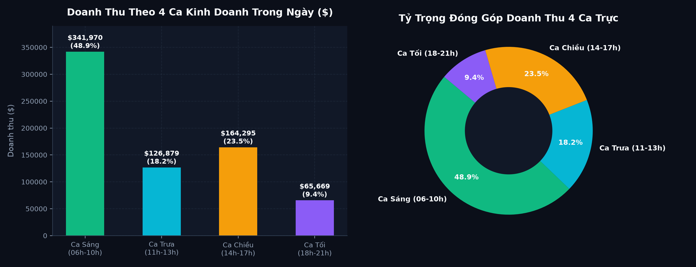

- **Phân tích hiệu suất theo 4 Ca trực (`time_slot`):**
  1. **Ca Sáng Cao Điểm (06:00 – 10:59):** Đạt **\$341,969.53** (**48.94%** tổng doanh thu). Nếu tính riêng 4 tiếng từ `07:00 – 10:59` đã chiếm **\$320,069.26 (45.80%)**!
  2. **Ca Chiều (14:00 – 17:59):** Đạt **\$164,294.90** (**23.51%** tổng doanh thu) — nguồn thu lớn thứ hai trong ngày.
  3. **Ca Trưa (11:00 – 13:59):** Đạt **\$126,879.38** (**18.16%** tổng doanh thu).
  4. **Ca Tối (18:00 – 20:59):** Chỉ đạt **\$65,668.52** (**9.40%** tổng doanh thu).

> 📌 **Kết luận Vận hành:** Gần **50% sinh mệnh doanh thu của quán nằm ở Ca Sáng (06h–10h)**. Ngược lại, khung giờ `20:00 – 21:00` tối chỉ thu về trung bình **\$16.22/ngày/tất cả 3 chi nhánh** (tức mỗi chi nhánh chỉ bán được ~3 ly trong suốt 1 tiếng cuối ngày!).

---

## 🎞️ SLIDE 18: PHÂN TÍCH SỨC MUA THEO THỨ TRONG TUẦN (THỨ 2 – CHỦ NHẬT)

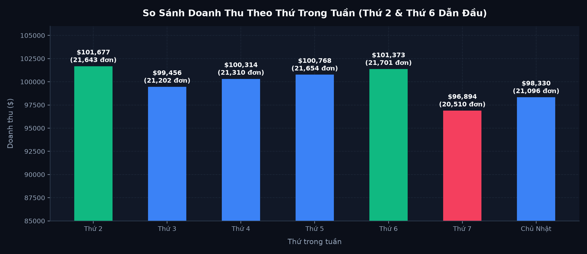

| Thứ trong tuần | Tên tiếng Anh | Doanh thu (\$) | Sản lượng (Món) | Số đơn hàng | Tỷ trọng (%) | Phân nhóm |
| :--- | :--- | :---: | :---: | :---: | :---: | :--- |
| **Thứ Hai** | `Monday` | **\$101,677.28** | **31,231** | 21,643 | **14.55%** | 🏆 **Cao nhất tuần (#1)** |
| **Thứ Ba** | `Tuesday` | \$99,455.94 | 30,449 | 21,202 | 14.23% | 🔵 Ngày làm việc ổn định |
| **Thứ Tư** | `Wednesday` | \$100,313.54 | 30,625 | 21,310 | 14.35% | 🟢 Vượt mốc \$100k |
| **Thứ Năm** | `Thursday` | **\$100,767.78** | 31,162 | 21,654 | **14.42%** | 🟢 **Cao thứ 3 tuần (#3)** |
| **Thứ Sáu** | `Friday` | **\$101,373.00** | 31,207 | **21,701** | **14.51%** | 🥈 **Cao thứ 2 tuần (#2 - Nhiều đơn nhất)** |
| **Thứ Bảy** | `Saturday` | **\$96,894.48** | **29,614** | **20,510** | **13.87%** | 🔻 **Thấp nhất tuần (#7)** |
| **Chủ Nhật** | `Sunday` | \$98,330.31 | 30,182 | 21,096 | 14.07% | 🔻 Thấp thứ 2 tuần (#6) |

- **Insight Hành vi Khách hàng:**
  - Khác với các quán cà phê giải trí thường đông vào cuối tuần, chuỗi **Maven Roasters phục vụ tệp khách hàng đi làm công sở (Commuters & Office Workers)**.
  - Do đó, **Thứ Hai đầu tuần (\$101,677)** và **Thứ Sáu cuối tuần làm việc (\$101,373)** đạt đỉnh doanh thu, trong khi **Thứ Bảy (\$96,894)** giảm khoảng ~4.7% do nhân viên văn phòng nghỉ làm.

---

## 🎞️ SLIDE 19: MA TRẬN NHIỆT BÁN HÀNG 2 CHIỀU (HEATMAP: THỨ × KHUNG GIỜ)

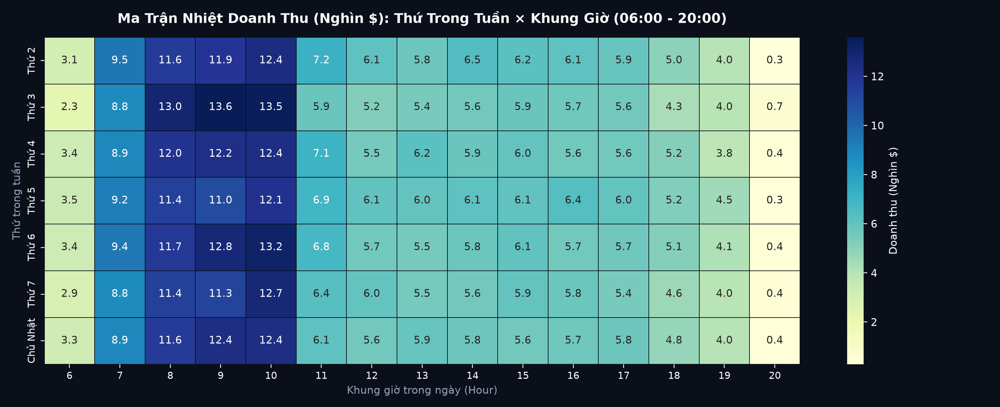

- **Đọc vị Ma trận nhiệt (2D Heatmap Analysis):**
  - **Vùng Nóng Đỏ / Xanh Đậm (Hot Zone):** Trải dài liên tục ở dải khung giờ **`08:00 – 10:59` từ Thứ Hai đến Thứ Sáu**, nơi mỗi khung giờ 1 tiếng trong từng thứ thu về từ **\$12,000 đến \$13,300**.
  - **Điểm nóng cực đại (Absolute Peak):** Khung **`10:00 sáng Thứ Ba & Thứ Sáu`** và **`09:00 sáng Thứ Hai`**.
  - **Vùng Lạnh (Cold Zone):** Khung giờ `06:00 sáng` và `19:00 – 20:00 tối` tất cả các ngày trong tuần.
- **Ứng dụng Quản trị:** Bảng Heatmap này là **"bản đồ chỉ huy"** giúp cửa hàng trưởng chia ca linh hoạt (Part-time 4 tiếng buổi sáng `07h–11h`) thay vì thuê nhân viên Full-time 8 tiếng ngồi rảnh rỗi vào buổi trưa và tối.

---

# 🟠 PHẦN V: PHÂN TÍCH SẢN PHẨM & DANH MỤC — "SẢN PHẨM NÀO MANG LẠI DOANH THU CAO?" (SLIDE 20 – SLIDE 25)
*Người trình bày đề xuất: **Ngọc Phước (Product & Customer Analytics)***

---

## 🎞️ SLIDE 20: CƠ CẤU TỶ TRỌNG 9 DANH MỤC SẢN PHẨM (`product_category`)

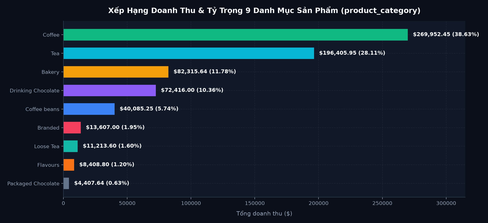

| Hạng | Danh mục (`product_category`) | Doanh thu (\$) | Sản lượng (Món) | Số đơn hàng | Đơn giá TB (\$) | Tỷ trọng Doanh thu (%) |
| :---: | :--- | :---: | :---: | :---: | :---: | :---: |
| **1** | **Coffee (Cà phê pha chế)** | **\$269,952.45** | **89,250** | **58,416** | \$3.02 | **38.63%** |
| **2** | **Tea (Trà các loại)** | **\$196,405.95** | **69,737** | **45,449** | \$2.82 | **28.11%** |
| **3** | **Bakery (Bánh nướng)** | **\$82,315.64** | 23,214 | 22,796 | \$3.55 | **11.78%** |
| **4** | **Drinking Chocolate (Sô-cô-la uống)**| **\$72,416.00** | 17,457 | 11,468 | \$4.15 | **10.36%** |
| **5** | **Coffee beans (Hạt cà phê gói)** | \$40,085.25 | 1,828 | 1,753 | **\$21.93** | **5.74%** |
| **6** | **Branded (Đồ lưu niệm thương hiệu)**| \$13,607.00 | 776 | 747 | **\$17.53** | **1.95%** |
| **7** | **Loose Tea (Trà búp đóng gói)** | \$11,213.60 | 1,210 | 1,210 | \$9.27 | **1.60%** |
| **8** | **Flavours (Syrup thêm hương vị)** | \$8,408.80 | 10,511 | 6,790 | **\$0.80** | **1.20%** |
| **9** | **Packaged Chocolate (Sô-cô-la hộp)**| \$4,407.64 | 487 | 487 | \$9.05 | **0.63%** |

> 🎤 **Lời thuyết trình (Ngọc Phước):**  
> *"Chuyển sang câu hỏi trọng tâm thứ hai: 'Sản phẩm và Danh mục nào mang lại doanh thu cao nhất?'. Nhìn vào biểu đồ xếp hạng 9 danh mục, Coffee dẫn đầu tuyệt đối với gần 270 ngàn đô la (chiếm 38.63%), đứng thứ hai là Tea với 196.4 ngàn đô la (chiếm 28.11%). Như vậy cứ 3 đô la thu về thì có 2 đô la đến từ Cà phê và Trà."*

---

## 🎞️ SLIDE 21: KIỂM CHỨNG QUY LUẬT PARETO 80/20 TRÊN DANH MỤC SẢN PHẨM

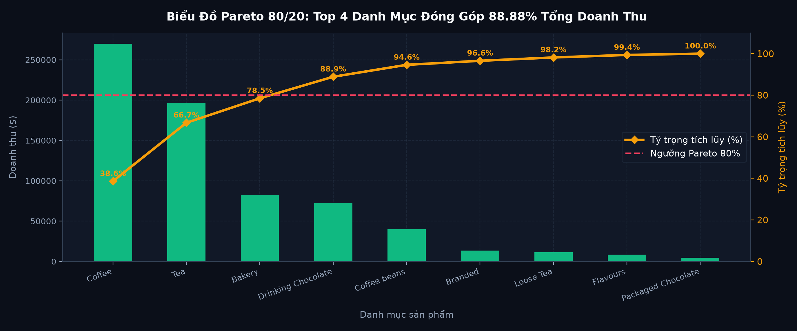

- **Phân tích Đường Tích lũy Pareto (Cumulative Share Curve):**
  - **Top 2 danh mục** (`Coffee` + `Tea`): Chiếm **66.74%** doanh thu và **74.13%** tổng sản lượng ly bán ra.
  - **Top 4 danh mục** (`Coffee` + `Tea` + `Bakery` + `Drinking Chocolate`): Đạt tỷ trọng tích lũy **88.88% tổng doanh thu (\$621,090.04 / \$698,812.33)** — vượt ngưỡng Pareto 80%!
  - **Nhóm Bán lẻ Đóng gói (`Coffee beans` + `Loose Tea` + `Branded` + `Packaged Chocolate`):** Tuy số lượng bán rất ít (chỉ 4,301 đơn vị, chiếm 2% sản lượng), nhưng nhờ **đơn giá rất cao (\$9.05 – \$45.00)** nên vẫn đóng góp **9.92% doanh thu (\$69,313.49)**.
  - **Nhóm Up-sell (`Flavours`):** Bán được tới **10,511 lượt syrup** (đơn giá \$0.80/lần bơm syrup), đóng vai trò gia tăng trải nghiệm hương vị cho dòng Espresso/Latte.

---

## 🎞️ SLIDE 22: TOP 10 DÒNG SẢN PHẨM CHỦ LỰC (`product_type`)

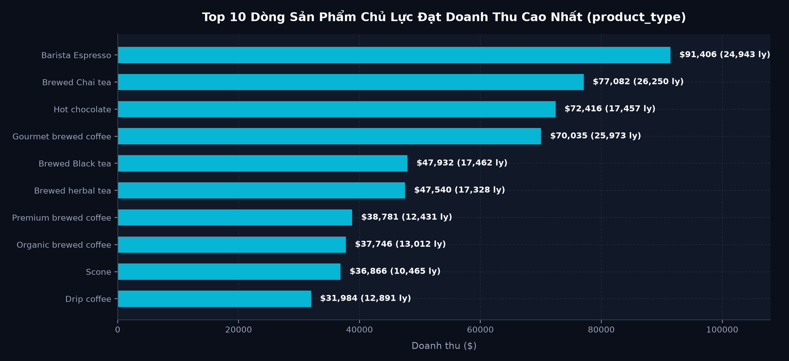

| Hạng | Dòng sản phẩm (`product_type`) | Danh mục gốc | Doanh thu (\$) | Sản lượng (Món) | Đơn giá TB (\$) | Tỷ trọng toàn chuỗi (%) |
| :---: | :--- | :--- | :---: | :---: | :---: | :---: |
| **1** | **Barista Espresso** | Coffee | **\$91,406.20** | 24,943 | \$3.66 | **13.08%** |
| **2** | **Brewed Chai tea** | Tea | **\$77,081.95** | **26,250** | \$2.94 | **11.03%** |
| **3** | **Hot chocolate** | Drinking Chocolate | **\$72,416.00** | 17,457 | **\$4.15** | **10.36%** |
| **4** | **Gourmet brewed coffee** | Coffee | **\$70,034.60** | 25,973 | \$2.70 | **10.02%** |
| **5** | **Brewed Black tea** | Tea | \$47,932.00 | 17,462 | \$2.74 | 6.86% |
| **6** | **Brewed herbal tea** | Tea | \$47,539.50 | 17,328 | \$2.74 | 6.80% |
| **7** | **Premium brewed coffee** | Coffee | \$38,781.15 | 12,431 | \$3.12 | 5.55% |
| **8** | **Organic brewed coffee** | Coffee | \$37,746.50 | 13,012 | \$2.90 | 5.40% |
| **9** | **Scone (Bánh nướng Scone)**| Bakery | \$36,866.12 | 10,465 | \$3.52 | 5.28% |
| **10**| **Drip coffee (Cà phê phin/lọc)**| Coffee | \$31,984.00 | 12,891 | \$2.48 | 4.58% |

- **Điểm nhấn chiến lược:**
  - **Barista Espresso** (gồm Latte, Cappuccino, Espresso, Mocha) là **"trái tim" của chuỗi cửa hàng**, mang về hơn **\$91.4k (13.08% tổng doanh thu)**.
  - **Brewed Chai tea** là dòng đồ uống có **sản lượng tiêu thụ lớn nhất toàn chuỗi (26,250 ly)**, vượt qua cả Gourmet brewed coffee.
  - Trong nhóm Bánh ngọt (`Bakery`), **Bánh Scone (\$36,866)** là món ăn kèm bán chạy số 1, bỏ xa Pastry (\$25,656) và Biscotti (\$19,794).

---

## 🎞️ SLIDE 23: TOP 10 MÓN CHI TIẾT MANG LẠI DOANH THU CAO NHẤT (`product_detail` — CASH COWS)

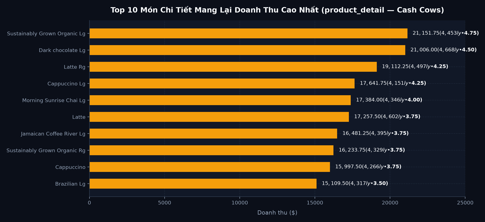

| Hạng | Tên món chi tiết (`product_detail`) | Danh mục | Size | Đơn giá (\$) | Sản lượng (Ly) | Tổng Doanh Thu (\$) |
| :---: | :--- | :--- | :---: | :---: | :---: | :---: |
| **1** | **Sustainably Grown Organic Lg** | Drinking Chocolate | **Large (Lg)** | **\$4.75** | 4,453 | **\$21,151.75** |
| **2** | **Dark chocolate Lg** | Drinking Chocolate | **Large (Lg)** | **\$4.50** | **4,668** | **\$21,006.00** |
| **3** | **Latte Rg** | Coffee | Regular (Rg) | \$4.25 | 4,497 | **\$19,112.25** |
| **4** | **Cappuccino Lg** | Coffee | **Large (Lg)** | \$4.25 | 4,151 | **\$17,641.75** |
| **5** | **Morning Sunrise Chai Lg** | Tea | **Large (Lg)** | \$4.00 | 4,346 | **\$17,384.00** |
| **6** | **Latte** | Coffee | Standard | \$3.75 | 4,602 | **\$17,257.50** |
| **7** | **Jamaican Coffee River Lg** | Coffee | **Large (Lg)** | \$3.75 | 4,395 | **\$16,481.25** |
| **8** | **Sustainably Grown Organic Rg** | Drinking Chocolate | Regular (Rg) | \$3.75 | 4,329 | **\$16,233.75** |
| **9** | **Cappuccino** | Coffee | Standard | \$3.75 | 4,266 | **\$15,997.50** |
| **10**| **Brazilian Lg** | Coffee | **Large (Lg)** | \$3.50 | 4,317 | **\$15,109.50** |

- **Phát hiện Đắt giá về Kích cỡ Ly (Size Effect):**
  - Trong Top 10 món mang lại doanh thu cao nhất toàn chuỗi, có tới **6 món là Size Large (`Lg`)**!
  - Nhờ mức giá nhỉnh hơn từ **\$0.75 – \$1.00/ly** so với size Regular/Small trong khi sản lượng bán tương đương (~4,300 – 4,600 ly), các món **Size Large** trở thành cỗ máy in tiền chủ lực.

---

## 🎞️ SLIDE 24: MA TRẬN ĐỊNH GIÁ — ĐƠN GIÁ TRUNG BÌNH VS. SẢN LƯỢNG BÁN (SCATTER BUBBLE)

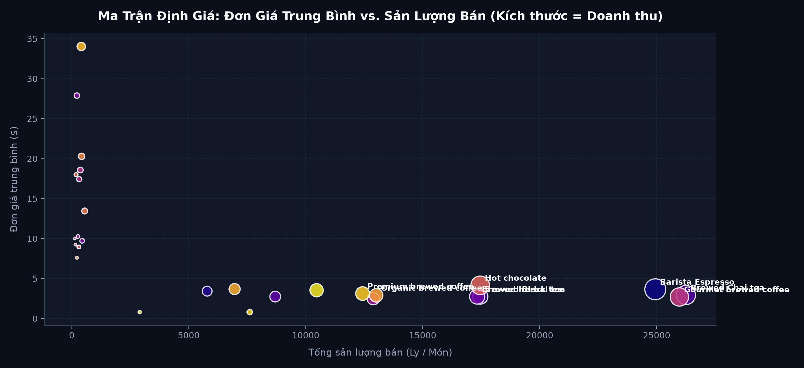

- **Phân tích 4 Phân khúc Sản phẩm trên Ma trận Giá – Sản lượng:**
  1. **Nhóm "Siêu Chủ Lực - High Volume & Sweet-spot Price" (\$2.50 – \$4.20 | >17,000 ly):** Gồm `Barista Espresso`, `Brewed Chai tea`, `Gourmet brewed coffee`, `Hot chocolate`, `Brewed Black/Herbal tea`. Đây là vùng giá tâm lý hoàn hảo mà khách hàng mua hàng ngày không đắn đo.
  2. **Nhóm "Bổ Trợ Tần Suất Khá" (\$2.50 – \$3.60 | 10,000 – 13,000 món):** Gồm `Scone`, `Premium/Organic/Drip coffee`, `Sugar free syrup`.
  3. **Nhóm "Cao Cấp Biên Lợi Nhuận Lớn - Premium Low Volume" (\$15.00 – \$28.00 | <1,000 đơn vị):** Gồm `Organic Beans`, `Espresso Beans`, `Gourmet Beans`, `Housewares/Clothing`. Tuy bán ít nhưng mỗi giao dịch mang về \$20–\$45.
  4. **Nhóm "Kém Hiệu Quả" (\$8.00 – \$12.00 | <500 đơn vị):** `Packaged Chocolate` (Sô-cô-la đóng hộp) — vừa không có lợi thế sản lượng vừa không có doanh thu cao.

---

## 🎞️ SLIDE 25: CƠ CẤU DANH MỤC THEO CHI NHÁNH NYC (CROSS-DIMENSIONAL ANALYSIS)

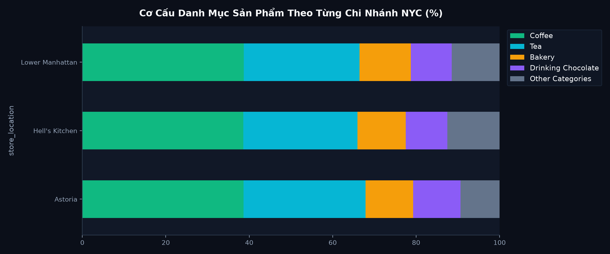

- **So sánh khẩu vị khách hàng giữa 3 chi nhánh (`Store Location × Product Category`):**
  - Tỷ trọng 4 nhóm chủ lực (`Coffee`, `Tea`, `Bakery`, `Drinking Chocolate`) cực kỳ đồng nhất trên cả 3 cơ sở (**chiếm ~88.5% – 89.2%** tại mỗi chi nhánh).
  - **Hell's Kitchen** có tỷ lệ tiêu thụ `Coffee beans` (hạt cà phê mang về) và `Flavours` nhỉnh hơn hai chi nhánh còn lại, trong khi **Lower Manhattan** tiêu thụ mạnh nhóm `Bakery` (bánh ăn sáng nhanh cho dân văn phòng).
- **Ý nghĩa Quản trị Chuỗi cung ứng:** Sự đồng nhất về cơ cấu tiêu thụ giúp bộ phận Thu mua (Procurement) dễ dàng **chuẩn hóa công thức đặt hàng nguyên vật liệu (Centralized Purchasing)** cho cả 3 chi nhánh theo cùng một tỷ lệ định mức.

---

# 🟡 PHẦN VI: HỆ THỐNG WEB DASHBOARD GENTELELLA V4 & KIẾN NGHỊ CHIẾN LƯỢC (SLIDE 26 – SLIDE 28)
*Người trình bày đề xuất: **Tân Lưu (Leader)***

---

## 🎞️ SLIDE 26: HỆ THỐNG WEB DASHBOARD ĐIỀU HÀNH (FLASK + GENTELELLA V4 DARK MODE)

- **Kiến trúc Kỹ thuật Web Dashboard ([`src/tan_luu_dashboard/`](src/tan_luu_dashboard/)):**
  - **Backend (`app.py`):** Xây dựng trên `Python Flask`, tích hợp bộ nhớ đệm in-memory (`_DF_MASTER`) giúp lọc và tổng hợp 149,116 dòng dữ liệu chỉ trong **< 35 mili-giây**.
  - **Frontend (`templates/index.html`):** Thiết kế theo chuẩn **Gentelella v4 Dark Mode** (`#0B0F19` / `#111827`) chống mỏi mắt cho nhà quản trị, sử dụng `Chart.js 4` và `Tailwind CSS`.
- **Các tính năng tương tác vượt trội khi Demo trực tiếp:**
  1. **Bộ lọc Đa chiều Thời gian thực (Live Multi-Filter):** Lọc đồng thời theo **Tháng (1–6)**, **Chi nhánh (3 Stores)**, **Danh mục (9 Categories)** và **Ô tìm kiếm từ khóa thông minh**.
  2. **Tự động cập nhật đồng bộ 100% giao diện:** Khi đổi bất kỳ bộ lọc nào, toàn bộ **6 thẻ KPI**, **Biểu đồ xu hướng tháng**, **Biểu đồ giờ**, **Biểu đồ thứ**, **Ma trận nhiệt Heatmap 2D**, **Donut danh mục**, **Top 10 món chủ lực**, **Biểu đồ Scatter Bubble** và **Bảng giao dịch** đều tự động vẽ lại ngay lập tức mà không cần tải lại trang (AJAX Fetch).
  3. **Xuất Báo cáo CSV theo bộ lọc (`/api/export_csv`):** Tải xuống ngay tập dữ liệu đã lọc chỉ với 1 nút bấm.

---

## 🎞️ SLIDE 27: 4 KIẾN NGHỊ CHIẾN LƯỢC QUẢN TRỊ DỰA TRÊN DỮ LIỆU (ACTIONABLE RECOMMENDATIONS)

| STT | Lĩnh vực | Phát hiện từ Dữ liệu (Data Insight) | Giải pháp Hành động Đề xuất (Actionable Strategy) | Tác động Kỳ vọng |
| :---: | :--- | :--- | :--- | :--- |
| **1** | **Nhân sự & Xếp ca (Workforce)** | Khung giờ vàng **`07:00 – 10:59` sáng** chiếm **45.80% tổng doanh thu**, trong khi **`20:00 – 20:59` tối** chỉ chiếm **0.42% (\$2,935)**. | • Bố trí **100% Barista tay nghề cao** vào ca sáng `07h–11h` (đặc biệt Thứ 2 & Thứ 6).<br>• Đóng quầy pha chế lúc **20:00** (thay vì 21:00) để tiết kiệm 1 giờ lương nhân sự & điện năng mỗi ngày. | Giảm **15% thời gian chờ** giờ cao điểm; Tiết kiệm **~540 giờ công/6 tháng**. |
| **2** | **Tối ưu Thực đơn & Up-sell (Menu Mix)** | **Size Large (`Lg`)** chiếm 6/10 món doanh thu cao nhất. Nhóm **Bakery** mới chỉ xuất hiện trong **15.3%** số hóa đơn; **AOV hiện tại là \$4.69**. | • Tạo **"Combo Sáng Công Sở" (1 Cà phê/Trà Size Lg + 1 Bánh Scone)** giảm giá \$0.50 vào khung `07h–10h`.<br>• Đào tạo thu ngân gợi ý khách **Up-size lên Large (+\$0.75)** và **thêm Syrup (+\$0.80)**. | Nâng **AOV từ \$4.69 lên \$5.30+** (+13% doanh thu toàn chuỗi). |
| **3** | **Kích cầu Giờ Trũng & Cuối Tuần (Promotions)** | Doanh thu sau 14:00 chiều giảm một nửa so với buổi sáng; **Thứ Bảy (\$96.9k)** là ngày thấp nhất tuần. | • Ra mắt chương trình **"Afternoon Tea Break (14h–17h)"**: Mua 2 ly `Brewed Chai/Herbal Tea` tặng 1 bánh `Biscotti`.<br>• Cuối tuần đẩy mạnh quầy dùng thử & bán gói **Hạt cà phê (`Coffee beans` \$21.93)** tại Astoria & Hell's Kitchen. | Tăng **10%–15% lưu lượng khách** khung giờ chiều và ngày Thứ Bảy. |
| **4** | **Quản trị Tồn kho (Inventory)** | **Top 4 danh mục** (`Coffee`, `Tea`, `Bakery`, `Drinking Chocolate`) tạo ra **88.88% doanh thu**. Nhóm `Packaged Chocolate` chỉ chiếm **0.63%**. | • Áp dụng định mức tồn kho an toàn tự động (Safety Stock) tăng thêm **25% mỗi tháng** vào quý II (Tháng 4–6).<br>• Cắt giảm 50% mã hàng `Packaged Chocolate` bán chậm để nhường quầy kệ cho `Coffee beans`. | Tránh đứt gãy nguyên liệu mùa cao điểm hè; Tối ưu vòng quay vốn lưu động. |

---

## 🎞️ SLIDE 28: TỔNG KẾT DỰ ÁN & PHIÊN HỎI – ĐÁP (Q&A)

- **Tổng kết Kết quả Đạt được của Nhóm:**
  1. **Về Kỹ thuật Dữ liệu (Tân Lê):** Xây dựng thành công pipeline làm sạch tự động 149,116 dòng dữ liệu với 0 lỗi khuyết thiếu và làm giàu thêm 11 trường đặc trưng phân tích.
  2. **Về Phân tích Nghiệp vụ (Quốc Thái & Ngọc Phước):** Giải mã toàn diện quy luật vận hành của chuỗi cà phê — định vị chính xác **"Khung giờ vàng 07h–10h sáng (45.8% doanh thu)"**, **"Đà tăng trưởng mùa vụ +103.8%"** và **"Quy luật Pareto 4 danh mục thống lĩnh 88.88% doanh số"**.
  3. **Về Sản phẩm Phần mềm (Tân Lưu):** Triển khai hoàn chỉnh hệ thống **Web Dashboard Gentelella v4 Dark Mode** trên nền tảng `Python Flask` + `Chart.js`, sẵn sàng phục vụ ra quyết định quản trị thời gian thực.

> 🎤 **Lời kết thuyết trình:**  
> *"Trên đây là toàn bộ báo cáo phân tích và hệ thống Dashboard trực quan hóa dữ liệu bán hàng chuỗi cà phê Maven Roasters của nhóm chúng em. Tiếp theo, nhóm xin phép chuyển sang phần Demo trực tiếp thao tác lọc dữ liệu trên Web Dashboard và rất mong nhận được các câu hỏi, góp ý từ Thầy/Cô và các bạn. Xin trân trọng cảm ơn!"*

---

## 📁 Danh Mục 16 File Biểu Đồ Độ Phân Giải Cao (`docs/charts/`) Để Chèn Vào Slide

| STT | Tên File Ảnh Biểu Đồ | Slide tương ứng | Nội dung biểu đồ |
| :---: | :--- | :---: | :--- |
| 1 | [`docs/charts/slide07_data_audit.png`](docs/charts/slide07_data_audit.png) | **Slide 7** | Kiểm định độ toàn vẹn 11 cột gốc & Quy mô giỏ hàng |
| 2 | [`docs/charts/slide08_price_qty_dist.png`](docs/charts/slide08_price_qty_dist.png) | **Slide 8** | Phân phối Đơn giá (`unit_price`) & Giá trị đơn hàng (`revenue`) |
| 3 | [`docs/charts/slide12_store_comparison.png`](docs/charts/slide12_store_comparison.png) | **Slide 12** | So sánh Tổng doanh thu & AOV giữa 3 chi nhánh NYC |
| 4 | [`docs/charts/slide13_store_monthly_trend.png`](docs/charts/slide13_store_monthly_trend.png) | **Slide 13** | Xu hướng tăng trưởng 6 tháng của từng chi nhánh |
| 5 | [`docs/charts/slide14_monthly_revenue_trend.png`](docs/charts/slide14_monthly_revenue_trend.png) | **Slide 14** | Xu hướng tăng trưởng doanh thu 6 tháng (+103.8%) |
| 6 | [`docs/charts/slide15_daily_sales_series.png`](docs/charts/slide15_daily_sales_series.png) | **Slide 15** | Chuỗi thời gian 181 ngày liên tục & Đường MA7 |
| 7 | [`docs/charts/slide16_hourly_peak_sales.png`](docs/charts/slide16_hourly_peak_sales.png) | **Slide 16** | Phân phối doanh thu & sản lượng qua 15 khung giờ (06h–20h) |
| 8 | [`docs/charts/slide17_time_slot_breakdown.png`](docs/charts/slide17_time_slot_breakdown.png) | **Slide 17** | Cơ cấu doanh thu & tỷ trọng 4 ca kinh doanh trong ngày |
| 9 | [`docs/charts/slide18_day_of_week_sales.png`](docs/charts/slide18_day_of_week_sales.png) | **Slide 18** | So sánh doanh thu theo Thứ trong tuần (Thứ 2 – Chủ Nhật) |
| 10 | [`docs/charts/slide19_heatmap_day_hour.png`](docs/charts/slide19_heatmap_day_hour.png) | **Slide 19** | Ma trận nhiệt 2 chiều (7 Thứ $\times$ 15 Khung giờ) |
| 11 | [`docs/charts/slide20_category_donut_bar.png`](docs/charts/slide20_category_donut_bar.png) | **Slide 20** | Xếp hạng doanh thu & tỷ trọng 9 danh mục sản phẩm |
| 12 | [`docs/charts/slide21_pareto_categories.png`](docs/charts/slide21_pareto_categories.png) | **Slide 21** | Biểu đồ Pareto 80/20 chứng minh Top 4 danh mục chiếm 88.88% |
| 13 | [`docs/charts/slide22_top10_product_types.png`](docs/charts/slide22_top10_product_types.png) | **Slide 22** | Top 10 dòng sản phẩm chủ lực (`product_type`) |
| 14 | [`docs/charts/slide23_top10_product_details.png`](docs/charts/slide23_top10_product_details.png) | **Slide 23** | Top 10 món chi tiết mang lại doanh thu cao nhất (`product_detail`) |
| 15 | [`docs/charts/slide24_price_vs_volume_scatter.png`](docs/charts/slide24_price_vs_volume_scatter.png) | **Slide 24** | Ma trận định giá: Đơn giá trung bình vs. Sản lượng bán |
| 16 | [`docs/charts/slide25_category_by_store_and_slot.png`](docs/charts/slide25_category_by_store_and_slot.png) | **Slide 25** | Cơ cấu danh mục sản phẩm theo từng chi nhánh NYC |
